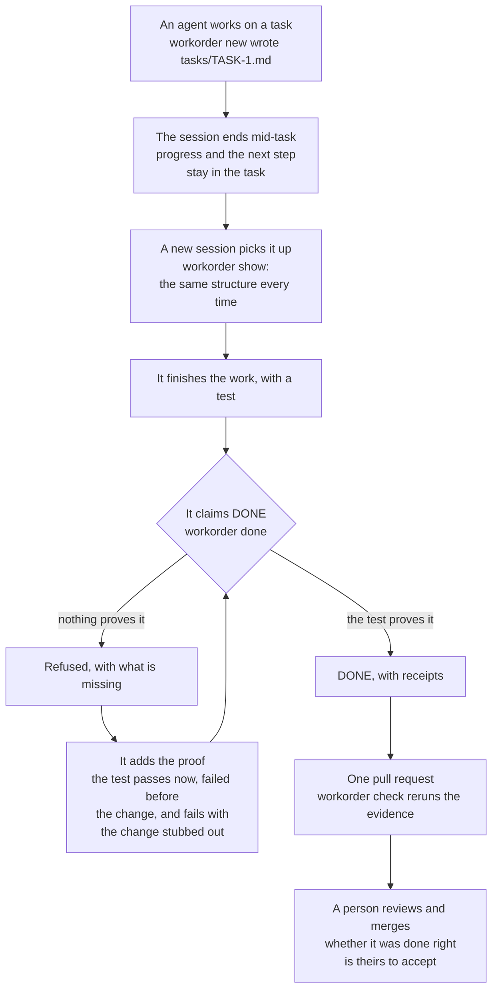

# Workorder: the task record for coding agents

A coding agent's session ends mid-task; the next session does not know what was being done, where it stopped or what remains. Workorder keeps the task outside the conversation, with the same structure every time: mission, scope, acceptance, test, dependencies, progress and the next step. Any later session or agent runs `workorder show` and recovers it, so tasks survive new conversations and handoffs.

Agents also say DONE when nothing proves it. Workorder refuses that DONE until the task's test passes now and failed on the code before the change (for Python code, also with the change stubbed out).

**A verified test result is not a verified task.** DONE means the test proves the change did something; whether the task was done right is a person's acceptance, a separate state recorded with `workorder accept`.




Every task is a Markdown file in `tasks/`; receipts go in `.workorder/`. `workorder done` refuses a DONE while Scope or Acceptance is empty.

[How it works](docs/how-it-works.md) · [Reviewer guide](docs/reviewer-guide.md) · [Reference](docs/reference.md) · [Guarantees and limits](docs/guarantees.md) · [Shortcuts Workorder flags](docs/shortcuts.md)

Needs Git and Python 3.10 or newer; no server or database. Tested in CI on Linux and Windows (Python 3.10, 3.12, 3.13).

## Quick start

Install with `pipx install workorder` ([no pipx?](docs/reference.md#team-setup)). Try it in a throwaway repository; a local `origin` stands in for GitHub:

```sh
mkdir demo && cd demo && git init -q -b main
git config user.name "Your Name" && git config user.email you@example.com
git init -q --bare ../demo-origin.git && git remote add origin ../demo-origin.git
workorder init
printf '__pycache__/\n' >> .gitignore
git add . && git commit -qm "Set up Workorder" && git push -qu origin main
```

The normal workflow is one branch and one pull request. Write the task on the branch, then fill in Scope and Acceptance in `tasks/TASK-1.md`:

```sh
git switch -c add-calc
workorder new --title "Add calc" --owner you --test "python3 test_calc.py" --code-paths calc.py
```

```markdown
## Scope

In: add two numbers with `add(a, b)` in calc.py. Out: subtraction.

## Acceptance

- `add(2, 2)` returns `4`.
```

Do the work with a test, commit, finish the task, commit, push and open one pull request:

```sh
printf 'def add(a, b):\n    return a + b\n' > calc.py
printf 'from calc import add\n\nassert add(2, 2) == 4\n' > test_calc.py
git add . && git commit -qm "TASK-1: add calc"
workorder done --task TASK-1 --note "add() works; next: subtraction"
git add tasks/ .workorder/ && git commit -qm "TASK-1 done" && git push -qu origin add-calc
```

If `done` refuses, follow its Next line. If the task's own code or test files changed, run `workorder renew --task <id>`.

The pull-request workflow runs `workorder check --base origin/main --run-tests --all-tests --require-task`; run it locally to see what reviewers see. For a task written and finished in one pull request, it asks for an approving review or the label `workorder-allow:TASK-1`. Working alone, use solo mode (`workorder init --solo`). Landing the task on main first is [an option](docs/reference.md#task-first-development).

## Language support

Any test command works; the deeper checks are Python-only today.

| Check | Python with pytest | Other test commands |
|---|---|---|
| Passes now | Yes | Yes, by exit code |
| Fails on the code before the change | Per new or changed test | Whole command |
| Fails with the changed functions stubbed out | Python code | Python code |
| Existing tests edited, removed or skipped | Per test | Per file in `test_paths` |
| Acceptance items tied to a test | Yes | No |

Wrappers such as `sh test.sh` need `--test-paths`; [full table](docs/reference.md#language-support).

## The review rule

An approving review clears every finding except changes to existing tests or the Workorder workflow file, which need a label from someone other than the author ([solo mode](docs/reference.md#solo-mode): the owner).

| Finding | What clears it |
|---|---|
| A finished task's test fails now, runs no tests, or times out | Fix it; nothing else |
| A DONE claim lacks evidence, or its code changed after it was finished | Finish the work or `workorder renew --task ID`, and commit the receipts |
| A task, receipt or configuration cannot be read; receipts edited or deleted; a dependency missing | Fix or restore the named file |
| A project test that already failed on the base | Nothing; it is a Note |
| A task written and finished in this pull request, or its Scope, Acceptance or dependencies changed | Approving review, or `workorder-allow:ID` |
| Changed code that no task records (`--require-task`) | Approving review, or `workorder-allow:no-task` |
| Changed code outside the task's `code_paths` | Approving review, or `workorder-allow:scope:ID` |
| The test asserts nothing, passes on the base code, or still passes with the change stubbed out | A better test; or approving review, or `workorder-allow:ID` |
| A refactor or no-code-change completion the base task did not declare | Approving review, or `workorder-allow:ID` |
| The test did not land first (`--require-test-first`) | Approving review, or `workorder-allow:ID` |
| The comparison with the base could not run | Fix the setup; or approving review, or `workorder-allow:ID` |
| A reopened task's test fails; a task retired; a finished task removed with all its receipts | Approving review, or `workorder-allow:ID` |
| An existing test edited, removed, skipped or weakened, or a task's test command or test paths changed | `workorder-allow:ID` (covers what `done --needs-review` recorded), or `workorder-allow:tests` for shared files; not an approving review |
| Existing tests fail on the new code, including the project test | `workorder-allow:ID` (covers what `done --needs-review` recorded), or `workorder-allow:tests` for project and unowned tests; not an approving review |
| The Workorder workflow file changed | `workorder-allow:workflow`; not an approving review |

The [reviewer guide](docs/reviewer-guide.md) explains each finding.

## Working with coding agents

Run `workorder init` in every clone (Git does not clone hooks); it also adds this block to AGENTS.md and CLAUDE.md:

```markdown
## Tasks
- Start from the task: if the repository has an origin remote, run `git fetch origin`. On main, update with `git pull --rebase origin main`. On a feature branch, merge or rebase main as needed. Run `workorder show --task <id>` and follow its Scope, Acceptance, test and progress.
- Set `WORKORDER_AGENT` when sharing a Git identity. Run `workorder claim --task <id>` before work.
- Do the work with a test that fails without it. Commit, then run `workorder done --task <id> --note "<what was done>"`. Report refusals; never claim completion after one or run `workorder accept`.
- Keep unfinished progress with `workorder note --task <id> --next "<next step>" "<progress>"`; done clears next.
- Never edit a task's status or receipts by hand. Commit tasks/ and .workorder/ with the work.
- Renew only when the task's own code or tests changed after DONE: `workorder renew --task <id>`.
- Before saying done, run `workorder check --base origin/main --run-tests --all-tests --require-task`.
- Shortened output is saved in full to `.git/workorder/last-output.txt`.
```

`workorder init --claude` also installs [Claude Code hooks](docs/reference.md#agent-hooks) for session start and stop.

## Speed

`done` runs the task's own test, and the tests of finished tasks whose code this change touches. On rich: `done` 3 s, pre-commit 3-4 s, documentation 0.2 s.

**Your whole suite runs once, in the pull-request check.** `init` turns this on when it finds pytest (`--no-project-test`: off).

## What it does not do

- It does not judge whether the task was done right: DONE is evidence; acceptance is a person's (`workorder accept` or a review).
- Local hooks can be skipped with `git commit --no-verify`; the pull-request check is what counts.
- It does not prove the software works in production or read agent conversations.

[Full reference](docs/reference.md) · [Team setup](docs/reference.md#team-setup) · [Examples](examples/) · [Contributing](CONTRIBUTING.md) · [MIT license](LICENSE)
