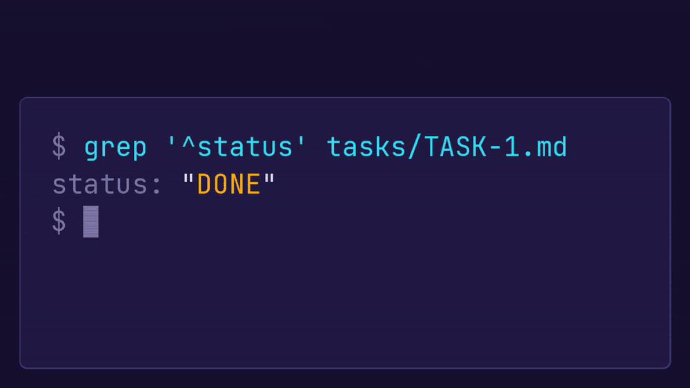

# NotQuite: Checks whether DONE actually means done.



```sh
pipx install notquite
```

No pipx? On Ubuntu or Debian: `sudo apt install pipx && pipx ensurepath`. Other systems: see the [pipx install guide](https://pipx.pypa.io/stable/how-to/install-pipx.html). Plain `pip install` outside a virtual environment is blocked on recent Ubuntu; the [quick start](#quick-start) uses one.

- A task's status is a claim; its actual state is computed from recorded evidence.
- DONE needs an implementation on a clean commit plus a passing latest test run on that exact commit. A later failing run revokes it.
- CLOSED can also require merge and deploy read-back evidence.
- Three lines in `CLAUDE.md` / `AGENTS.md` hook it into Claude Code or Codex ([see below](#using-it-with-coding-agents)).

## Why

A task says DONE. The tests ran on an older commit. The latest changes were never checked.

Or the tests passed and the code was merged, then came a deploy nobody read back.

**NotQuite checks the evidence behind task status.**

Tasks are Markdown files. Each implementation is tied to a Git commit, and test results are recorded against that exact commit. If the required evidence is missing or outdated, DONE fails.

CLOSED can require more: a merge, a deployment check, and a live read-back command that returned the expected commit ID.

You can also define acceptance criteria and specify what evidence counts. A mock result cannot satisfy a requirement for real evidence.

It runs on Git and Python's standard library. No server or database. Tested in CI on Linux and Windows (Python 3.10, 3.12, 3.13).

Receipts catch missing or stale evidence, but they are not signed and cannot prevent deliberate forgery.

## See it fail

A test passed on one commit. Then the code changed, and the task was marked DONE without testing again:

```text
$ notquite check TASK-1
NOT QUITE  TASK-1

  Claimed:  DONE
  Computed: IN_PROGRESS
  Commit:   cfd328a
  Test:     no passing test for this commit; the last test ran on 945c15e
  Missing:  a passing test on cfd328a
  Next:     notquite receipt test --task TASK-1 -- <your test command>

  Result: NOT DONE. The status says DONE; the evidence above does not support it.
```

The exit code is 1, so a hook or CI job stops here. Running the tests through NotQuite records what actually happened. In this case the change broke them:

```text
$ notquite receipt test --task TASK-1 -- python test_calc.py
Traceback (most recent call last):
  ...
AssertionError
TASK-1 test cfd328a exit 1 - recorded
command: python test_calc.py
TASK-1 still owes: a passing test on cfd328a
```

## Quick start

Requires Git and Python 3.10 or newer. This uses a throwaway folder and needs no remote. On Windows, run the commands in Git Bash and activate with `. .venv/Scripts/activate`.

```sh
python3 -m venv .venv && . .venv/bin/activate
python -m pip install notquite

mkdir demo && cd demo
git init -q -b main
git config user.name "Your Name"
git config user.email you@example.com

printf 'def add(a, b):\n    return a + b\n' > calc.py
printf 'from calc import add\n\nassert add(2, 2) == 4\n' > test_calc.py
printf '__pycache__/\n' > .gitignore
git add . && git commit -qm "Add calc"

notquite new --title "Add calc" --owner you --ships none
notquite receipt implemented --task TASK-1
notquite receipt test --task TASK-1 -- python test_calc.py
notquite check TASK-1
```

The last command ends with `Claimed: IN_PROGRESS` and `Computed: CLOSED`. That is expected: the `status` line in `tasks/TASK-1.md` is your claim, and NotQuite never edits it. The evidence already supports CLOSED (this task ships nothing), so setting `status: CLOSED` would now pass `notquite check`.

To see it fail, change `calc.py`, commit, run `notquite receipt implemented --task TASK-1`, set `status: DONE` in `tasks/TASK-1.md`, and run `notquite check TASK-1` again.

Run `notquite` at the root of your repository. Commit `tasks/` and `.notquite/` along with your code; CI checks what is committed.

## How tasks work

`notquite new` writes `tasks/TASK-1.md`. With an `origin` remote, it first reserves the id there, so two clones cannot take the same id. Without one, it numbers tasks locally and says so; those ids are not coordinated with anyone else.

```markdown
---
id: "TASK-1"
title: "Add calc"
owner: "you"
status: "IN_PROGRESS"
ships: "none"
waits_on: []
contract: "none"
---

# TASK-1

Write the original ask here.
```

- `status` is the claim: `IN_PROGRESS`, `BLOCKED`, `DONE` or `CLOSED`. You edit it. NotQuite never trusts it.
- `ships` sets what CLOSED needs: `none`, `repo` or `live`.
- `waits_on` lists `task:TASK-2` (met when that task computes DONE or CLOSED) or `person:alex` (remove it when answered).
- `contract` is `none` or a path to a contract file (see below).

Front matter is a small subset: single-line text, JSON strings and JSON lists, not full YAML. Details are in [docs/reference.md](https://github.com/Argento17/notquite/blob/main/docs/reference.md).

## What counts as DONE

1. `notquite receipt implemented` on a clean, committed tree. Uncommitted or untracked code is refused, so build output belongs in `.gitignore`.
2. The latest `notquite receipt test -- <command>` on that same commit exited 0, with nothing changed while it ran. A later failure revokes DONE until a later run passes; every run stays in the receipts.
3. Every critical contract criterion met, if there is a contract.
4. Nothing left in `waits_on`: each `task:` wait computes DONE or CLOSED, and no `person:` wait remains.

A test recorded before the latest implementation, on another commit, or while files or HEAD changed does not count. Each `receipt test` runs the command itself and records the real exit code. A failed command makes `notquite` exit 1.

## What counts as CLOSED

DONE, plus what the task ships:

| `ships` | Also needs |
|---|---|
| `none` | nothing |
| `repo` | `receipt merged`: the tested code is on `origin`'s `main` (`--ref refs/heads/<branch>` to change) |
| `live` | the merge, then `receipt deployed --target <name> -- <command>`, then a later `receipt live --target <name> -- <command>` |

A deployment or live read-back counts when its command exits 0 and its output contains the expected full commit ID. NotQuite reads back; it does not deploy. A passing read-back shows that the command returned that commit ID, nothing more. `receipt merged` reads from `origin`, so `repo` and `live` tasks need a remote.

`notquite check` refuses DONE or CLOSED when the evidence falls short. `notquite show --task TASK-1` prints the recorded and computed status, and `notquite ready` lists open work.

## Contracts and evidence

A contract maps each original ask to a criterion and says what evidence counts:

```json
{
  "task": "TASK-3",
  "criteria": [
    {
      "id": "C1",
      "ask": "Items remain after reloading the running app",
      "critical": true,
      "requires": "REAL",
      "evidence": [{"provenance": "MOCK", "ref": "a simulated browser result"}]
    }
  ]
}
```

| Label | Meaning | Can satisfy |
|---|---|---|
| `REAL` | a file in the repository and its `sha256` | `REAL`, `REAL_OR_TEST` |
| `TEST` | `receipt:<hash>` of a passing test on the implemented commit | `REAL_OR_TEST` only |
| `MOCK`, `SYNTHETIC`, `UNKNOWN` | recorded for honesty | nothing |

Critical criteria must be met before DONE. This contract fails: a mock result cannot satisfy a request for real output. `REAL` is a label the author declares, so the file and its hash prove which file was meant, not where it came from. See [examples/](https://github.com/Argento17/notquite/tree/main/examples) for sample tasks and this contract.

## Using it with coding agents

NotQuite checks task files and recorded evidence. It does not watch conversations, so a claim made only in chat is not caught. Tell the agent to use it. Add this to `CLAUDE.md` (Claude Code) or `AGENTS.md` (Codex):

```markdown
## Task completion
- Before working on a task in tasks/, run `notquite claim --task <id>` (needs an origin remote); run `notquite release --task <id>` when you stop.
- After committing code, run `notquite receipt implemented --task <id>`, then run tests through `notquite receipt test --task <id> -- <test command>`.
- Never set status DONE or CLOSED unless `notquite check <id>` passes. If it fails, report its Missing lines instead of saying the task is done.
```

## Git claims

`notquite claim --task TASK-1` pushes a tag to `origin`. If another clone already holds the task, Git rejects the push and the claim fails. `notquite release` works only in the clone that made the claim. That clone keeps a random token in its `.git` folder, and the claim tag stores only the token's SHA-256 hash, so reading the repository does not let anyone else release the claim. Release adds another tag, so the history stays on `origin`. `notquite claims` lists holders.

Ids, claims and releases live under `refs/tags/notquite/`. Hosting sites list them with your other tags, and `git fetch --tags` downloads them. Git refuses to overwrite a tag without force, but anyone with push access can force-push or delete one. If that matters, protect `notquite/*` tags in your repository settings.

Claims always need `origin`. Without a remote there are no claims at all: NotQuite refuses `claim` rather than keep a local claim that nobody else could see. If `origin` is configured but unreachable, `new` and `claim` refuse rather than guess.

## CI and hooks

CI tells you a commit passed. NotQuite tells you whether a task's DONE is backed by a passing latest test on the commit that task implemented, and whether merge and deployment read-backs were recorded for that code.

GitHub Actions (`.github/workflows/notquite.yml` in your project):

```yaml
name: NotQuite
on: [pull_request]
permissions: {contents: read}
jobs:
  check:
    runs-on: ubuntu-latest
    steps:
      - uses: actions/checkout@v4
        with: {fetch-depth: 0}   # receipts refer to earlier commits
      - uses: actions/setup-python@v5
        with: {python-version: '3.12'}
      - run: python -m pip install notquite==0.1.0
      - run: notquite check
```

Pre-commit hook, to refuse committing a false DONE:

```sh
printf '#!/bin/sh\nexec notquite check --staged\n' > .git/hooks/pre-commit
chmod +x .git/hooks/pre-commit
```

## Limitations

- Receipts are hash-chained and append-only against committed history. They are not signed. Anyone who can write files can forge one, and rewriting Git history rewrites the proof. NotQuite catches missing and stale evidence, not deliberate forgery.
- A passing test is only as good as its assertions.
- Only task files are checked. Claims made in chat, issues or pull request text are not.
- Receipts and claims record your Git `user.name` and your computer's hostname, and both are pushed.
- Tag-based claims depend on your remote's permissions (see [Git claims](#git-claims)).

## Contributing

Bug reports and small pull requests are welcome. See [CONTRIBUTING.md](https://github.com/Argento17/notquite/blob/main/CONTRIBUTING.md).

Feedback, issues and ideas welcome, and a star if you find it useful.

## License

MIT. See [LICENSE](https://github.com/Argento17/notquite/blob/main/LICENSE).
