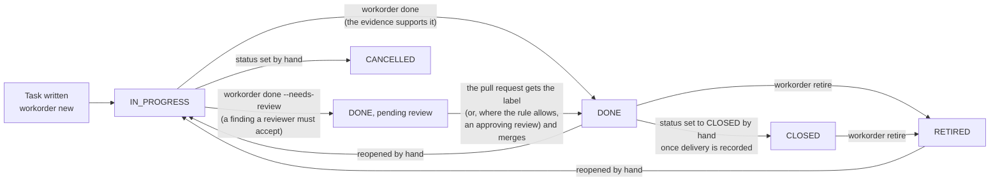
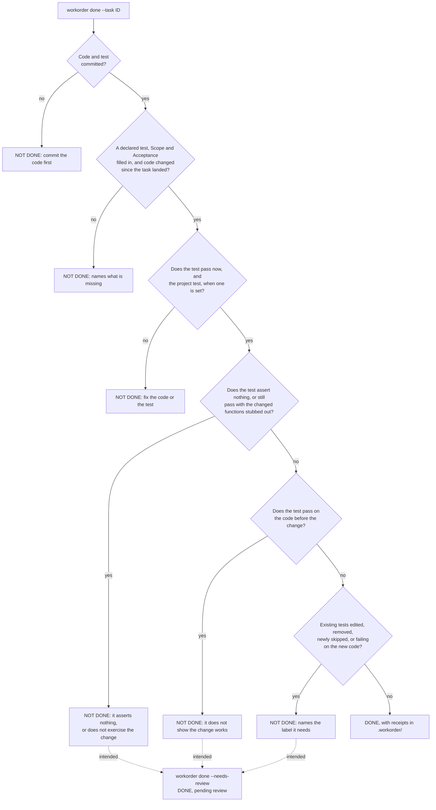
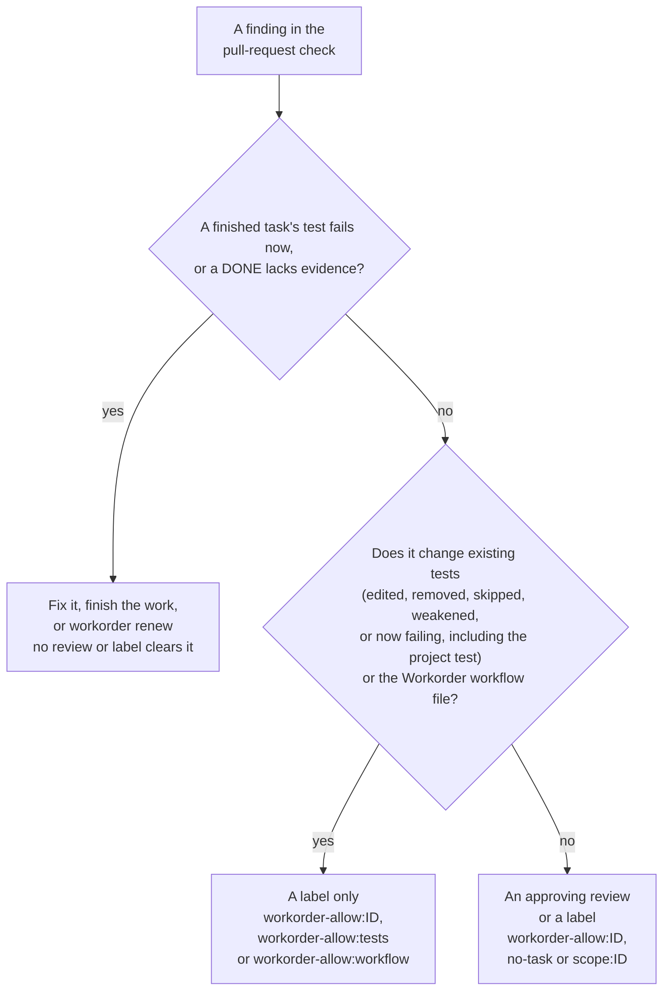

# How Workorder works

A coding agent's session can end mid-task, and the next one starts without knowing what was done or what remains. Agents also say DONE when nothing shows the work was done.

Workorder gives every task the same structure. `workorder new` writes each one in the same form: mission, scope, acceptance, test command, dependencies and progress, and the code paths when you name them. Every task follows the same lifecycle, and every agent session starts from `workorder show` and ends with `workorder done`, or with `workorder note --next` when the work is unfinished. So any agent or person who picks up a task finds it in the same form, checked the same way.

The proof of DONE comes from the task's own test: `workorder done` writes DONE only when the test passes now, fails on the code before the change, and fails with the change stubbed out. It refuses while Scope or Acceptance is empty.

The three charts below show a task's life, what `workorder done` checks, and what a reviewer can accept in a pull request. The task files live in `tasks/` and the receipts of each test run in `.workorder/`.

## A task's life

`workorder new` writes the task as IN_PROGRESS; there is no separate open status, and BLOCKED is set by hand while work waits. Only `done` writes DONE, and only when the checks below pass; with `--needs-review` it writes DONE and records the findings a reviewer must accept, with no status edit needed after the review. CLOSED is DONE plus delivery (`ships: none` needs nothing more, `repo` the merge, `live` also deployment read-backs), and the pull-request check treats DONE to CLOSED as a new claim. Retiring a DONE or CLOSED task, cancelling a task, or reopening a finished task whose test now fails needs an approving review or the label `workorder-allow:ID` in the pull request.

## What `workorder done` checks

`done` stops at the first refusal and prints what is missing and the next step; the last two questions are one comparison with the base, so their findings come together. The stubbed-out check covers changed Python functions only, and a task declared as a refactor or verification (`--refactor`, `--no-code-change`) need not fail on the code before. A refusal leaves the status as it was; `done` never commits or pushes.

## The review rule

Labels must come from someone other than the pull request's author, and an approving review must come from another person and cover the current head. A project test that already failed on the base is only a Note. Each refusal names what clears it; the [reviewer guide](reviewer-guide.md) has the full table and explains each finding.
